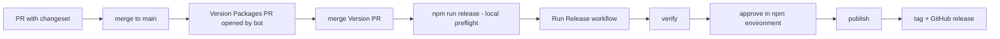

# Maintaining

How releases work and the one-time setup that cannot be expressed in code.

## Release flow

1. Contributors add a changeset (`npm run changeset`) with each user-facing change. CI fails a
   PR that changes `src/`, `docs/` or `README.md` without one; use `npm run changeset -- --empty`
   to opt out deliberately. Make `changeset present` a required check (see setup below).
2. Merging to `main` makes `version.yml` open/update a **Version Packages** PR (bumps
   `package.json` and the lockfile, writes `CHANGELOG.md`).
3. Merge that PR when you want to release. CI's `scope` job sees that the merge only changes
   release metadata (changesets, `CHANGELOG.md`, version fields) and, if the previous `main`
   commit already has a green CI run, skips the test matrix. CodeQL does not run for it either.
   Any other change, or a previous commit without green CI, runs the full matrix.
4. Locally, `git pull` and run `npm run release`. It checks: version/lockfile/changelog agree,
   no pending changesets, clean and pushed tree, and that the version is not already on the
   registry. It never publishes.
5. Start the release: `gh workflow run release.yml -f confirm-version=<version>` (or the
   Actions UI). The workflow runs only from the default branch and:
   - requires a green `CI` run for that exact commit,
   - re-runs the preflight and full `npm run verify`,
   - packs one tarball, records its SHA-256 and uploads it,
   - waits for approval on the `npm` environment,
   - re-checks the registry, verifies the checksum and publishes **that tarball** with
     provenance (`latest` for stable versions, `next` for prereleases such as `1.2.0-beta.1`),
   - confirms the dist-tag, then creates the `vX.Y.Z` tag and GitHub release.
6. If publishing succeeded but the final job failed, **do not republish**. Re-run only the
   failed `finalize` job; it refuses to move an existing tag.

Prereleases: `npx changeset pre enter next` ... `npx changeset pre exit`.

## One-time setup per package (not done by code)

1. **npm trusted publisher** — on npmjs.com open the package → Settings → Trusted publisher,
   choose GitHub Actions and set owner/repo, workflow `release.yml`, environment `npm`.
   *Unverified:* whether npm lets you register a trusted publisher before the package's first
   version exists. If not, publish the first version once with a short-lived granular token
   and then switch to trusted publishing and revoke the token. Check npm's current docs.
2. **`npm` environment with reviewers** — Settings → Environments → New environment `npm` →
   Required reviewers (and restrict deployment branches to `main`). Environment protection
   rules on private repos need a paid plan. CLI alternative:
   `gh api -X PUT repos/OWNER/REPO/environments/npm --input -` with a `reviewers` array.
3. **Actions permission** — Settings → Actions → General → enable "Allow GitHub Actions to
   create and approve pull requests" (needed by `version.yml`). PRs opened with the default
   token do not trigger CI; close and reopen the Version PR (or use a GitHub App/PAT) so
   required checks run.
4. **Branch protection for `main`** - require pull requests and these checks, with the source set
   to GitHub Actions: the eight `verify (<os>, node <22|24>, mongoose <8.24.5|9.11.2>)` jobs, the
   two `integration (mongodb 7.0, mongoose <version>)` jobs, `scale (ubuntu, node 24)` and
   `changeset present`. `npm audit` is advisory; restrict who can push. Names change when the
   matrix changes, so update the list with it.
5. **Security features** — enable Dependabot alerts/updates, secret scanning and private
   vulnerability reporting.
6. Update `.github/CODEOWNERS` if the owner differs.

## Maintenance

- Node support: edit `engines.node`, `.nvmrc`, the matrix in `ci.yml` and `nodeTarget` in
  `boilerplate.config.json` together.
- Size budget and coverage thresholds live in `boilerplate.config.json`; raising limits needs
  a deliberate review.
- Action versions are pinned to commit SHAs; Dependabot proposes updates.
- Adding a subpath export: add an entry under `entries` in `boilerplate.config.json`, an
  `exports` branch (with `types` before `default`) in `package.json`, and a test. `npm run
  test:package` verifies ESM/CJS parity for every export.
- Dependencies: a package with runtime dependencies keeps them out of the bundle automatically
  (`build.mjs` marks them external); add them to `dependencies`, not `devDependencies`.

## Release readiness checklist

Code-side gates are `npm run verify`, `npm run test:scale` and `npm run pack:check`; CI
re-runs them on the exact commit and the Release workflow refuses to start without a green CI run.
These cannot be established from the repository and must be confirmed by a maintainer:

- npm scope permission and the trusted-publisher binding (setup step 1)
- the protected `npm` environment with a real reviewer (setup step 2)
- green CI on the full matrix for the release commit (or, for a version-only commit, for the
  previous `main` commit it reuses)
- adoption in a real consuming application (see [migration guide](docs/migration.md)); until then,
  production stability is unproven
- explicit authorization to publish

## First publish without GitHub access

When the Release workflow cannot be dispatched (or npm has no trusted publisher yet), a maintainer can do a one-time bootstrap publish: `npm login`, then `npm run publish:bootstrap`. It requires a clean `main` equal to `origin/main`, an unpublished version, a full `npm run verify` and a typed version confirmation, then publishes with `--ignore-scripts` (no provenance). Afterwards configure the trusted publisher and use the workflow for every later release.
